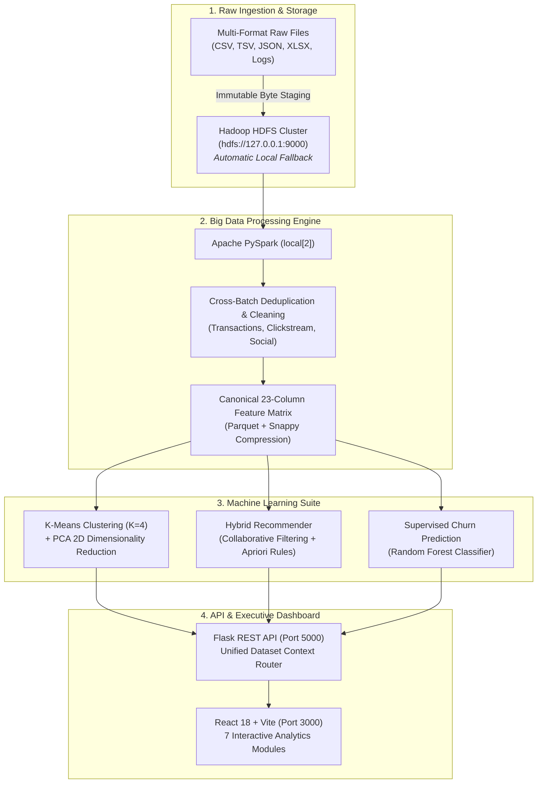
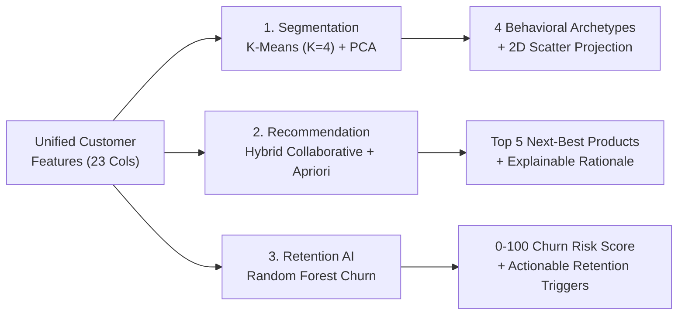

# SMART Big Data Platform — System Architecture

A high-performance big data analytics and machine learning platform combining **Apache Hadoop HDFS**, **Apache PySpark**, and a **Scikit-Learn ML Suite** with a modern **React 18** executive dashboard.

---

## 1. End-to-End System Architecture

---

## 2. Pipeline Execution Stages

1. **Raw Storage (Hadoop HDFS):**
   - Untouched raw customer files are committed immutably to `/customer-analytics/raw/uploads/<batch_id>/` for audit compliance.
   - If Hadoop is offline, the system automatically uses local Parquet staging without failure.
2. **Distributed Compute (Apache PySpark):**
   - In-memory distributed DAG execution.
   - Cleans nulls, standardizes schemas, and deduplicates primary keys across historical batches.
   - Aggregates multi-source customer touchpoints into a unified **23-column Customer Feature Matrix**.
3. **Machine Learning Intelligence:**
   - Retrains clustering, recommender, and churn models with version-isolated artifacts.
4. **Reactive Serving (Flask + React):**
   - Synchronous context switching across all 7 frontend dashboard modules.

---

## 3. The 3 Core Machine Learning Models

### Model 1: K-Means Clustering + PCA (Customer Segmentation)
* **Goal:** *"Who are our customer types?"*
* **How it works:**
  - Evaluates 22 behavioral attributes to group customers into 4 data-driven personas: **VIP Tech Spenders**, **Bargain Hunters**, **Brand Advocates**, and **Active Value Shoppers**.
  - **PCA (Principal Component Analysis)** compresses 22 feature dimensions into 2 orthogonal axes (PC1, PC2) capturing ~56% variance to project clusters on a 2D scatter plot.

### Model 2: Hybrid Personalized Recommender (Next-Best Product)
* **Goal:** *"What should this customer buy next, and why?"*
* **How it works:**
  - **Collaborative Filtering:** Cosine similarity across customer purchasing vectors (*"Customers like you also bought..."*).
  - **Market Basket Analysis (Apriori):** Co-occurrence rules ($A \rightarrow B$) with Support $\ge 0.01$ and Lift $> 1.05\times$ (*"Frequently bought together"*).
  - **Validation:** Evaluated via zero-leakage 80/20 train/test holdout, delivering a **~78.7% Hit Rate@5**.

### Model 3: Supervised Churn Prediction (Retention AI)
* **Goal:** *"Who is about to leave in the next 90 days?"*
* **How it works:**
  - **Random Forest Classifier:** Evaluates recency decay, frequency drops, and sentiment drop-offs to predict 90-day inactivity.
  - Outputs a **0–100 Churn Risk Score**, risk tiers (Low/Medium/High), and tailored retention actions.
  - **Temporal Integrity Protocol:** Strictly requires a 270-day observation window (180d historical + 90d forward observation); automatically skipped for short batches to prevent target leakage.

---

## 4. Dual Processing Modes

| Mode | Dataset Scope | Typical Speed | Purpose |
| :--- | :--- | :--- | :--- |
| **Cumulative Analysis** | Baseline + All Accepted Batches + Incoming | 2–3 mins | Full enterprise audit, cross-batch deduplication, and historical ML retraining. |
| **New Batch Only** | Current Uploaded Batch Only | ~1.5 secs | Rapid student demonstration and isolated batch previews without historical unions. |

---

## 5. Technology Stack

* **Storage:** Apache Hadoop HDFS 3.3.6, Apache Parquet (Snappy compressed).
* **Processing:** Apache PySpark 3.5.1, Python 3.11, Pandas, NumPy.
* **Machine Learning:** Scikit-Learn 1.4, SciPy, Joblib.
* **Backend:** Flask 3.1 REST API, Flask-CORS.
* **Frontend:** React 18, Vite, Lucide Icons, Chart.js / React-Chartjs-2.
