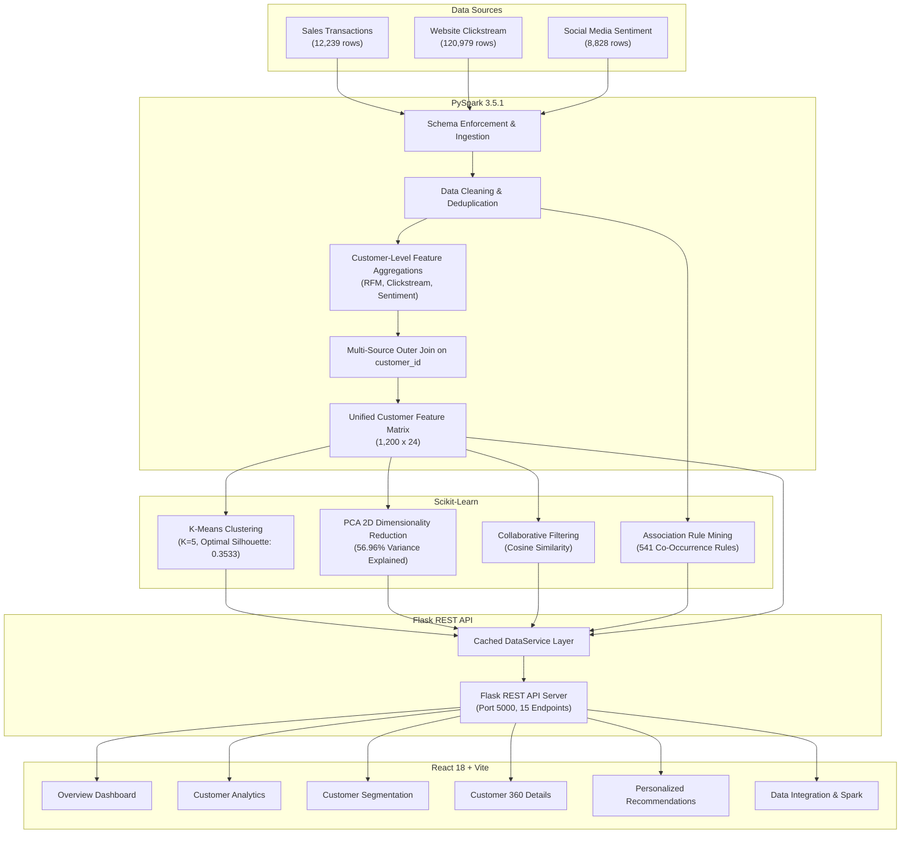

# Academic Project Report

## Project Title: Smart Customer Analysis and Personalized Experience Using Big Data

---

### Executive Summary

Modern enterprise e-commerce platforms generate massive, high-velocity data streams spanning transactional sales records, real-time web browsing clickstreams, and external social media user sentiment. Traditional relational database management systems (RDBMS) struggle with horizontal scalability, schema heterogeneity, and the computational complexity of multi-source behavioral feature extraction. 

This project presents an end-to-end Big Data & Machine Learning system designed for academic demonstration and real-world applicability. The platform ingests multi-source customer datasets (sales transactions, website interactions, and social media reviews) unified by a common customer identity. Distributed batch transformations and data cleaning are orchestrated using **Apache Spark (PySpark 3.5.1)** in a memory-optimized local environment. Using the engineered behavioral feature matrix, unsupervised **K-Means clustering** ($K=5$) is applied to identify distinct customer behavioral segments, supported by Elbow and Silhouette analysis. To drive personalized customer engagement, a hybrid recommendation system is developed combining **user-based collaborative filtering** and **Market Basket association rule mining** with an explicit explainability layer. Finally, an interactive web dashboard developed in **React 18** and **Chart.js** interfaces with a lightweight **Flask REST API** to visualize the live data processing, segmentation, and recommendation results.

---

### System Architecture

The overall system architecture follows a decoupled, 5-tier modular pipeline:

---

### Mathematical Formulations

#### 1. RFM Behavioral Feature Extraction
For each customer $u \in U$, given transactions $T_u = \{t_1, t_2, \dots, t_n\}$:
- **Recency ($R_u$)**:
  $$R_u = \Delta_{\text{days}}(t_{\text{ref}}, \max_{t \in T_u}(\text{date}(t)))$$
  where $t_{\text{ref}}$ is the fixed benchmark reference date (2025-01-01).
- **Frequency ($F_u$)**:
  $$F_u = |\{t \in T_u : \text{status}(t) = \text{'Completed'}\}|$$
- **Monetary Spend ($M_u$)**:
  $$M_u = \sum_{t \in T_u, \text{status}(t) = \text{'Completed'}} \text{total\_amount}(t)$$
- **Average Order Value ($AOV_u$)**:
  $$AOV_u = \frac{M_u}{F_u} \quad (\text{for } F_u > 0)$$

#### 2. Feature Standardization
Before distance-based clustering, all features $x \in \mathbb{R}^d$ are standardized using z-score normalization:
$$z_{ij} = \frac{x_{ij} - \mu_j}{\sigma_j}$$
where $\mu_j$ is the mean of feature $j$, and $\sigma_j$ is its standard deviation.

#### 3. K-Means Objective Function (Within-Cluster Sum of Squares)
The algorithm partitions $N = 1,200$ customers into $K$ disjoint clusters $C = \{C_1, C_2, \dots, C_K\}$ by minimizing the objective:
$$J = \sum_{k=1}^K \sum_{x_i \in C_k} \| x_i - \mu_k \|^2$$
where $\mu_k = \frac{1}{|C_k|} \sum_{x \in C_k} x$ is the centroid of cluster $k$.

#### 4. Clustering Evaluation Metrics
- **Silhouette Coefficient**:
  $$s(i) = \frac{b(i) - a(i)}{\max(a(i), b(i))}$$
  where $a(i)$ is the mean intra-cluster distance of sample $i$, and $b(i)$ is the mean nearest-cluster distance. The overall score is $\bar{s} = \frac{1}{N}\sum_{i=1}^N s(i)$.
- **Davies-Bouldin Index**:
  $$DB = \frac{1}{K} \sum_{i=1}^K \max_{j \ne i} \left( \frac{\bar{d}_i + \bar{d}_j}{d(\mu_i, \mu_j)} \right)$$
  where $\bar{d}_i$ is the average distance of samples in cluster $i$ to their centroid $\mu_i$.

#### 5. User-Based Collaborative Filtering (Cosine Similarity)
The similarity between two customer interaction vectors $\mathbf{u}, \mathbf{v} \in \mathbb{R}^P$ across $P = 30$ catalog products is computed as:
$$\text{sim}(\mathbf{u}, \mathbf{v}) = \cos(\theta) = \frac{\mathbf{u} \cdot \mathbf{v}}{\|\mathbf{u}\|_2 \|\mathbf{v}\|_2} = \frac{\sum_{p=1}^P u_p v_p}{\sqrt{\sum_{p=1}^P u_p^2} \sqrt{\sum_{p=1}^P v_p^2}}$$

The predicted preference score $\hat{r}_{u, p}$ for candidate item $p$ from the top $K$ nearest neighbors $N(u)$ is:
$$\hat{r}_{u, p} = \frac{\sum_{v \in N(u)} \text{sim}(\mathbf{u}, \mathbf{v}) \cdot r_{v, p}}{\sum_{v \in N(u)} |\text{sim}(\mathbf{u}, \mathbf{v})|}$$

#### 6. Market Basket Association Mining
For antecedent item $A$ and consequent item $B$:
- **Support**:
  $$\text{Support}(A \rightarrow B) = \frac{\text{Transactions containing } A \text{ and } B}{\text{Total Transactions}}$$
- **Confidence**:
  $$\text{Confidence}(A \rightarrow B) = P(B | A) = \frac{\text{Support}(A \cap B)}{\text{Support}(A)}$$
- **Lift**:
  $$\text{Lift}(A \rightarrow B) = \frac{\text{Confidence}(A \rightarrow B)}{\text{Support}(B)} = \frac{P(A \cap B)}{P(A) \cdot P(B)}$$
  A lift $> 1.0$ indicates positive correlation between co-purchases.

---

### Experimental Results & Validation Summary

#### A. PySpark Data Processing Audit
| Check | Raw Input Rows | Duplicates Removed | Missing Values Imputed | Final Output Rows |
| :--- | :--- | :--- | :--- | :--- |
| **Sales Transactions** | 12,239 | 25 | 73 (`payment_method` $\rightarrow$ `'Unknown'`) | 12,214 |
| **Website Clickstream** | 120,979 | 35 | 60,540 null product IDs preserved | 120,944 |
| **Social Media Reviews** | 8,828 | 0 | 0 | 8,828 |
| **Unified Feature Matrix** | N/A | 0 | 0 unexpected nulls | **1,200 rows $\times$ 24 columns** |

#### B. Discovered Behavioral Segments ($K=5$)
| Cluster | Persona Title | Size | Share | Mean Spend | Mean Recency | Mean Web Actions | Mean Sentiment |
| :---: | :--- | :---: | :---: | :---: | :---: | :---: | :---: |
| **0** | **Casual Occasional Shoppers** | 348 | 29.0% | \$483.53 | 80.4 days | 40.3 | $+0.3548$ |
| **4** | **Active Bargain Hunters** | 306 | 25.5% | \$1,399.53 | 27.7 days | **190.0** | $+0.1991$ |
| **1** | **High-Value VIP Tech Spenders** | 204 | 17.0% | **\$4,634.37** | **18.4 days** | 137.1 | $+0.7471$ |
| **3** | **Social Brand Advocates** | 174 | 14.5% | \$1,179.01 | 33.7 days | 88.5 | **$+0.8183$** |
| **2** | **At-Risk / Dissatisfied Customers**| 168 | 14.0% | \$359.26 | **281.6 days** | 32.1 | **$-0.6527$** |

---

### Conclusion & Future Scope

The completed system validates that multi-source enterprise data can be unified and mined on lightweight hardware (8 GB RAM) using open-source big data frameworks. PySpark ensures distributed scalability, Scikit-learn delivers explainable clustering and recommendations, and the Flask-React stack provides an intuitive analytics dashboard for business decision-makers.

**Future Enhancements**:
1. Streaming Ingestion: Extending PySpark batch pipelines to Spark Structured Streaming via Apache Kafka for real-time clickstream recommendations.
2. Deep Learning Embeddings: Implementing Two-Tower Neural Recommenders or Graph Neural Networks (GNN) for high-dimensional user-item interaction modeling.
3. Multi-Node Deployment: Scaling the standalone single-node setup across a distributed multi-node Hadoop YARN cluster in cloud environments.
